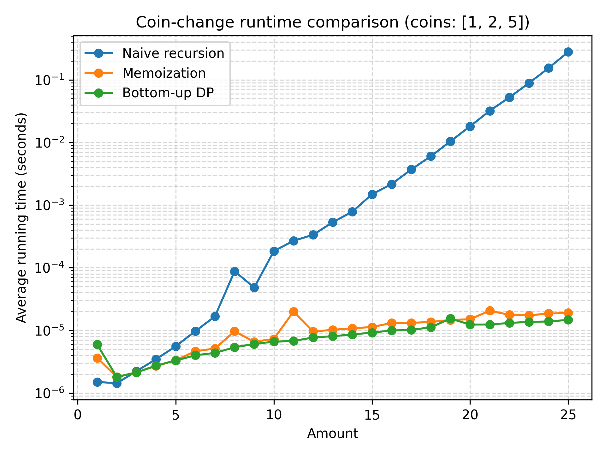

To measure and compare the running times of all 3 of the functions, I used matplotlib and perf_counter to create a plot that compared the coins that were the examples in the README file of 1, 2, and 5 and showcased the running times with amounts all the way up to 25 as the x axis and the running time in log time as the y axis. The first function created, naive recursion, is clearly the worst performing in terms of running time which makes sense because of what recursion does compared to the others, running remainders and amounts over and over again as the overall amount increases. The overall running time is very close between the other 2 functions with what appears as hardly any difference. Based on this, I assume memoization with caching reappearing amounts is very similar in efficiency to the bottom up approach because they, in a way, do the same thing as the bottom up approach makes the cache that memoization would use. 